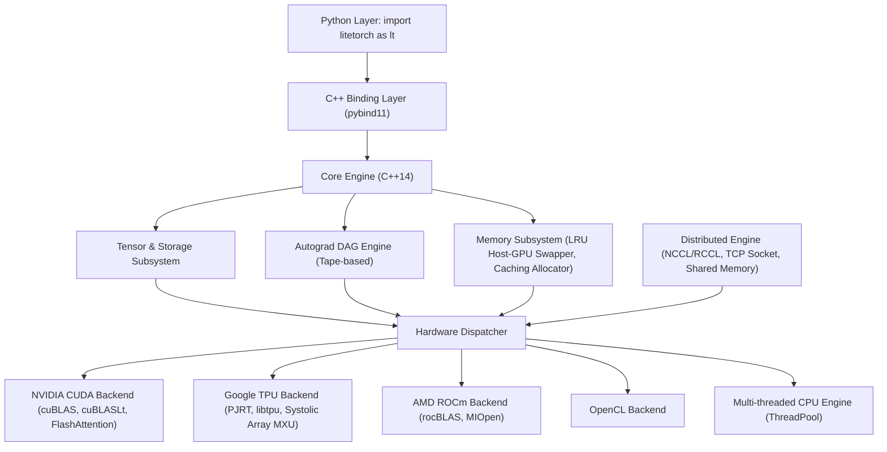

# LiteTorch Documentation

LiteTorch is a lightweight, high-performance deep learning framework and large language model (LLM) training runtime built in native C++14 with Python bindings via `pybind11`.

This documentation covers the full workflow: installing the framework, learning it hands-on, looking up every public API, and understanding how the engine works underneath.

---

## How to use these docs

The docs are organized in four layers, following the PyTorch documentation model. Start at the layer that matches what you are doing right now.

| Layer | What it is | Who it is for |
| :--- | :--- | :--- |
| **Tutorials** | Learn-by-doing guides that run start to finish: tensors and autograd, training a classifier, fine-tuning and serving an LLM, quantizing and fusing a model | New users; anyone learning LiteTorch for the first time |
| **How-to guides** | Task-based recipes: train on 2 GPUs, set up FSDP / TP / PP / CP, quantize a model, serve with paged attention, deploy on mobile/ARM, use tokenizers, debug a failing run | Users with a concrete task to complete |
| **API reference** | Every public op, class, and function: signature, parameters and defaults, dtypes, shapes, returns, edge cases, a runnable example, and the PyTorch equivalent | Users who know what they need and want the exact contract |
| **Explanations** | Concepts: tensor and autograd, memory eviction, backends, distributed parallelism, JIT fusion, quantization numerics, LLM serving, the C++ embedding | Users who want to understand why the framework behaves the way it does |

Two more pages sit alongside the four layers and are worth reading early:

- **Migration guide from PyTorch** — an API mapping table (LiteTorch mirrors the PyTorch API in most places) plus the porting notes that save the most time.
- **Behavioral differences vs PyTorch** — every known deviation from PyTorch, named with its justification and migration. PyTorch is the reference standard for LiteTorch numerics and behavior; a deviation that is not documented here is a bug, not a feature.

---

## Navigation

### Front matter

| Page | File | Description |
| :--- | :--- | :--- |
| Documentation overview | [index.md](index.md) | This page: how to use the docs, navigation, architecture |
| Installation | [installation.md](installation.md) | pip, source build, CUDA / ROCm / OpenCL / CPU, Windows, environment variables, verification |
| Installation on Docker | [installation/docker.md](installation/docker.md) | Containerized install (CPU and CUDA images) |
| Installation on Kaggle | [installation/kaggle.md](installation/kaggle.md) | Notebook setup, GitHub-fetch-only delivery, GPU pre-flight checks, session hygiene |
| Quickstart | [quickstart.md](quickstart.md) | 60-minute entry: tensors, autograd, modules, data loading, a training loop, checkpointing |
| Glossary | [glossary/vi-terms.md](../glossary/vi-terms.md) | English–Vietnamese technical terms (single source of truth for the Vietnamese docs) |
| Migration guide from PyTorch | *in progress* | API mapping table LiteTorch ↔ PyTorch |
| Behavioral differences vs PyTorch | *in progress* | Every known deviation, justified and documented |
| Troubleshooting and FAQ | *in progress* | Build failures, OOM, silent CPU fallback, backend detection |
| Changelog | *in progress* | Version notes per release |

### Tutorials

| Tutorial | Description |
| :--- | :--- |
| T1. 60-minute blitz | Tensors, autograd, a training loop |
| T2. Train a classifier | MNIST / CIFAR, CPU and GPU variants, expected accuracy |
| T3. Fine-tune and serve an LLM | Flash attention, paged attention |
| T4. Quantize and JIT-fuse a model | End-to-end quantization + fusion |

### How-to guides

| Guide | Description |
| :--- | :--- |
| H1. Train on 2 GPUs | NCCL collectives, mismatch-throw, launch |
| H2. Distributed: FSDP / TP / PP / CP | Sharded and parallel training setup |
| H3. Quantize a model | QAT / PTQ, FP8 / INT8 / INT4 / NF4 |
| H4. Serve with paged attention | Continuous batching setup |
| H5. Deploy on mobile / ARM | Cross-compile, OpenCL dlopen, binary size |
| H6. Tokenizers and HF models | HuggingFace tokenizers, `lt.hf.from_pretrained` |
| H7. Data loading at scale | DataLoader, checkpointing, `.lt` format |
| H8. Debug a run | gradcheck, parity vs PyTorch, OOM diagnosis |

### API reference

| Group | Entries | Description |
| :--- | :--- | :--- |
| Tensor class, factories, attributes | ~65 | `Tensor`, creation functions, methods, dunders |
| Top-level functions | ~48 | Creation, RNG / seed, serialization, grad-mode |
| Ops: elementwise / math | ~45 | Arithmetic, trig, activations |
| Ops: reduction / shape / indexing | ~30 | sum / mean / max, cat / stack / gather |
| Ops: conv / pool / norm / attention / LLM | ~35 | Convolution, pooling, normalization, flash attention |
| Ops: losses / quant / FP8 / fused | ~15 | Loss functions, quantized and fused kernels |
| nn modules | 99 | Containers, linear, conv, norm, activation, recurrent, attention, losses, serving |
| nn.functional / nn.init / nn.utils | 26 | Functional ops, initializers, parameter utilities |
| optim, schedulers, AMP | 26 | SGD / Adam / AdamW / 8-bit, LR schedulers, GradScaler |
| linalg / fft / distributions | 56 | Linear algebra, FFT, probability distributions |
| data / Trainer / serialization | ~15 | Dataset, DataLoader, Trainer, save / load |
| distributed | 53 | ProcessGroup, FSDP, TP, PP, CP, DTensor |
| quantization / JIT / ONNX / HF / inference / prune | ~40 | Calibrator, QAT, JIT tracer, ONNX export, HF loading |
| cuda / tpu / autograd / enums | ~25 | Device management, `DataType`, `DeviceType` |
| C++ API | 15+ | Headers, classes, functions not bound to Python |
| Python subpackages | ~35+ | `ltvision`, `lttext`, `ltaudio`, `ltmobile`, and more |

### Explanations

| Page | Description |
| :--- | :--- |
| Tensor and autograd | Signatures, broadcasting, in-place semantics, edge cases |
| Memory eviction | The framework differentiator: concept, allocator knobs, OOM diagnosis |
| Backends | CUDA / ROCm / OpenCL / CPU / TPU, detection, silent-fallback hazards |
| Distributed | 4D parallelism, collectives reference, NCCL, failure modes |
| JIT fusion | Tracer op list, fusion eligibility, numerics caveats |
| Quantization numerics | Fake-quantize bounds, FP8 scales |
| LLM serving concepts | Paged attention, batching, speculative decoding, limits |
| C++ embedding | Error contract, pybind11 boundary, build flags |

### Platform guides

| Page | Description |
| :--- | :--- |
| Mobile / ARM deployment | Cross-compile CPU backend for aarch64 + Android NDK, OpenCL dlopen, binary size |
| Tokenizers | HuggingFace tokenizers package, feeding token IDs to models, `lt.hf.from_pretrained` |
| Installation on a personal machine | Linux workstation + Windows server, CPU or a single GPU, pre-flight gate, first local training run |
| Installation on AWS | EC2 GPU instances (DLAMI or plain Ubuntu), SageMaker, ECS, EKS |
| Installation on Azure | N-series GPU VMs, Azure ML compute |
| Installation on Google Cloud Platform | Deep Learning VM or plain-image GPU VMs, Vertex AI |
| Installation on other clouds | Lambda, OCI, RunPod, Paperspace, CoreWeave |

---

## Version

These docs track the LiteTorch tree. Baseline: **agent-v1@02cc271a** (local HEAD 88a4ba1). The tree moves while the rewrite is in progress; every code example carries a metadata header pinning the commit it was verified against, and the final verification pass (Batch B5) re-checks all examples against the head at that time. If a page and the tree disagree, trust the tree and report the page as a defect.

---

## Architecture overview

---

## Key capabilities

1. **Standalone high-performance C++ core**: zero Python Global Interpreter Lock (GIL) latency and self-contained runtime.
2. **Modern LLM kernels**: built-in support for FlashAttention, Grouped-Query Attention (GQA), Rotary Position Embedding (RoPE), SwiGLU, RMSNorm, and PagedAttention.
3. **4D distributed scaling**:
   - Fully Sharded Data Parallel (FSDP / ZeRO-3)
   - Tensor Parallelism (TP)
   - Pipeline Parallelism (PP 1F1B)
   - Context Parallelism (CP / Ring Attention)
4. **Optimized memory management**:
   - Caching block allocator reducing device allocation overhead.
   - Automatic LRU memory eviction swapping between Host RAM and Device VRAM.
   - Activation checkpointing reducing backward activation memory by 60% to 70%.
5. **Multi-platform hardware acceleration**: automatic hardware detection for NVIDIA CUDA, Google Cloud TPU (v2-v5p, v6e Trillium, v7 Ironwood, v8 8t/8i via PJRT and `libtpu.so`), AMD ROCm, OpenCL, and multi-threaded CPU fallback.
