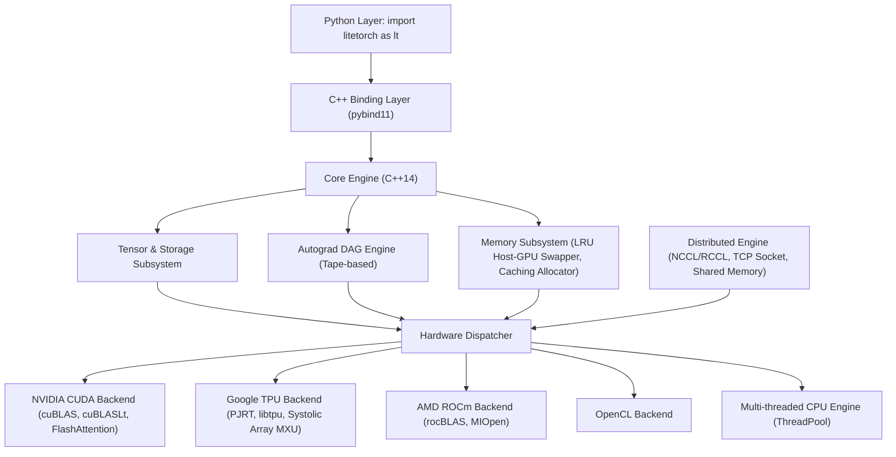

# Tài Liệu LiteTorch

LiteTorch là một framework học sâu (deep learning) và runtime huấn luyện mô hình ngôn ngữ lớn (LLM) hiệu năng cao, được xây dựng hoàn toàn bằng ngôn ngữ C++14 với giao diện lập trình Python thông qua `pybind11`.

Bộ tài liệu này bao quát toàn bộ quy trình làm việc: cài đặt framework, học qua thực hành, tra cứu mọi API công khai, và hiểu cách engine vận hành bên dưới.

---

## Cách sử dụng bộ tài liệu này

Tài liệu được tổ chức thành bốn tầng, theo mô hình tài liệu của PyTorch. Hãy bắt đầu ở tầng phù hợp với việc bạn đang làm.

| Tầng | Nội dung | Dành cho |
| :--- | :--- | :--- |
| **Tutorials** | Hướng dẫn học qua thực hành, chạy được từ đầu đến cuối: tensor và đạo hàm tự động, huấn luyện một mô hình phân loại, fine-tune và phục vụ một LLM, lượng tử hóa và hợp nhất mô hình | Người mới; bất kỳ ai lần đầu học LiteTorch |
| **How-to guides** | Công thức theo nhiệm vụ: huấn luyện trên 2 GPU, thiết lập FSDP / TP / PP / CP, lượng tử hóa một mô hình, phục vụ với paged attention, triển khai trên mobile/ARM, dùng tokenizer, gỡ lỗi một lần chạy | Người dùng có một nhiệm vụ cụ thể cần hoàn thành |
| **API reference** | Mọi op, class và function công khai: chữ ký, tham số và giá trị mặc định, kiểu dữ liệu, shape, giá trị trả về, trường hợp biên, một ví dụ chạy được, và API tương đương trong PyTorch | Người dùng đã biết mình cần gì và muốn xem đúng hợp đồng API |
| **Explanations** | Khái niệm: tensor và đạo hàm tự động, giải phóng bộ nhớ, backend, huấn luyện phân tán, JIT fusion, số học lượng tử hóa, phục vụ LLM, nhúng C++ | Người dùng muốn hiểu vì sao framework hành xử như vậy |

Hai trang nữa nằm cạnh bốn tầng và nên đọc sớm:

- **Hướng dẫn migration từ PyTorch** — bảng ánh xạ API (LiteTorch phản chiếu API PyTorch ở hầu hết các chỗ) cùng các ghi chú porting tiết kiệm thời gian nhất.
- **Điểm khác biệt hành vi so với PyTorch** — mọi điểm khác biệt đã biết so với PyTorch, kèm lý do và cách migration. PyTorch là chuẩn tham chiếu cho số học và hành vi của LiteTorch; một điểm khác biệt không được ghi lại ở đây là một lỗi, không phải một tính năng.

---

## Điều hướng

### Trang mở đầu

| Trang | File | Mô tả |
| :--- | :--- | :--- |
| Tổng quan tài liệu | [index.md](index.md) | Trang này: cách dùng tài liệu, điều hướng, kiến trúc |
| Cài đặt | [installation.md](installation.md) | pip, biên dịch từ mã nguồn, CUDA / ROCm / OpenCL / CPU, Windows, biến môi trường, kiểm tra cài đặt |
| Cài đặt trên Docker | [installation/docker.md](installation/docker.md) | Cài đặt trong container (image CPU và CUDA) |
| Cài đặt trên Kaggle | [installation/kaggle.md](installation/kaggle.md) | Thiết lập notebook, chỉ lấy mã nguồn qua GitHub, kiểm tra tiền điều kiện GPU, giữ session sống |
| Bắt đầu nhanh | [quickstart.md](quickstart.md) | Lối vào 60 phút: tensor, đạo hàm tự động, module, nạp dữ liệu, vòng lặp huấn luyện, checkpoint |
| Glossary | [glossary/vi-terms.md](../glossary/vi-terms.md) | Thuật ngữ kỹ thuật Anh–Việt (nguồn duy nhất cho tài liệu tiếng Việt) |
| Hướng dẫn migration từ PyTorch | *đang viết* | Bảng ánh xạ API LiteTorch ↔ PyTorch |
| Điểm khác biệt hành vi so với PyTorch | *đang viết* | Mọi điểm khác biệt đã biết, có lý do và tài liệu đầy đủ |
| Xử lý sự cố và FAQ | *đang viết* | Lỗi biên dịch, OOM, fallback CPU âm thầm, nhận diện backend |
| Changelog | *đang viết* | Ghi chú phiên bản theo từng release |

### Tutorials

| Tutorial | Mô tả |
| :--- | :--- |
| T1. Blitz 60 phút | Tensor, đạo hàm tự động, một vòng lặp huấn luyện |
| T2. Huấn luyện một mô hình phân loại | MNIST / CIFAR, biến thể CPU và GPU, độ chính xác kỳ vọng |
| T3. Fine-tune và phục vụ một LLM | Flash attention, paged attention |
| T4. Lượng tử hóa và hợp nhất JIT một mô hình | Lượng tử hóa + fusion trọn vẹn |

### How-to guides

| Hướng dẫn | Mô tả |
| :--- | :--- |
| H1. Huấn luyện trên 2 GPU | Collectives NCCL, lỗi mismatch, cách khởi chạy |
| H2. Phân tán: FSDP / TP / PP / CP | Thiết lập huấn luyện sharded và song song |
| H3. Lượng tử hóa một mô hình | QAT / PTQ, FP8 / INT8 / INT4 / NF4 |
| H4. Phục vụ với paged attention | Thiết lập continuous batching |
| H5. Triển khai trên mobile / ARM | Cross-compile, OpenCL dlopen, kích thước binary |
| H6. Tokenizer và mô hình HF | Tokenizer HuggingFace, `lt.hf.from_pretrained` |
| H7. Nạp dữ liệu ở quy mô lớn | DataLoader, checkpoint, định dạng `.lt` |
| H8. Gỡ lỗi một lần chạy | gradcheck, parity so với PyTorch, chẩn đoán OOM |

### API reference

| Nhóm | Số mục | Mô tả |
| :--- | :--- | :--- |
| Class Tensor, factory, thuộc tính | ~65 | `Tensor`, hàm tạo, phương thức, dunder |
| Hàm cấp cao nhất | ~48 | Tạo tensor, RNG / seed, serialization, chế độ grad |
| Ops: elementwise / math | ~45 | Số học, lượng giác, activation |
| Ops: reduction / shape / indexing | ~30 | sum / mean / max, cat / stack / gather |
| Ops: conv / pool / norm / attention / LLM | ~35 | Convolution, pooling, chuẩn hóa, flash attention |
| Ops: loss / quant / FP8 / fused | ~15 | Hàm loss, kernel lượng tử hóa và fused |
| Module nn | 99 | Container, linear, conv, norm, activation, recurrent, attention, loss, serving |
| nn.functional / nn.init / nn.utils | 26 | Op dạng functional, khởi tạo trọng số, tiện ích tham số |
| Optimizer, scheduler, AMP | 26 | SGD / Adam / AdamW / 8-bit, LR scheduler, GradScaler |
| linalg / fft / distributions | 56 | Đại số tuyến tính, FFT, phân phối xác suất |
| data / Trainer / serialization | ~15 | Dataset, DataLoader, Trainer, save / load |
| distributed | 53 | ProcessGroup, FSDP, TP, PP, CP, DTensor |
| quantization / JIT / ONNX / HF / inference / prune | ~40 | Calibrator, QAT, JIT tracer, xuất ONNX, nạp HF |
| cuda / tpu / autograd / enum | ~25 | Quản lý thiết bị, `DataType`, `DeviceType` |
| API C++ | 15+ | Header, class, function không bind sang Python |
| Subpackage Python | ~35+ | `ltvision`, `lttext`, `ltaudio`, `ltmobile`, và các package khác |

### Explanations

| Trang | Mô tả |
| :--- | :--- |
| Tensor và đạo hàm tự động | Chữ ký, broadcasting, ngữ nghĩa in-place, trường hợp biên |
| Giải phóng bộ nhớ | Điểm khác biệt của framework: khái niệm, núm điều chỉnh allocator, chẩn đoán OOM |
| Backend | CUDA / ROCm / OpenCL / CPU / TPU, nhận diện, rủi ro fallback âm thầm |
| Phân tán | Song song hóa 4D, tham chiếu collectives, NCCL, chế độ lỗi |
| JIT fusion | Danh sách op của tracer, điều kiện fusion, lưu ý số học |
| Số học lượng tử hóa | Giới hạn fake-quantize, scale FP8 |
| Khái niệm phục vụ LLM | Paged attention, batching, speculative decoding, giới hạn |
| Nhúng C++ | Hợp đồng lỗi, ranh giới pybind11, cờ biên dịch |

### Hướng dẫn theo nền tảng

| Trang | Mô tả |
| :--- | :--- |
| Triển khai Mobile / ARM | Cross-compile backend CPU cho aarch64 + Android NDK, OpenCL dlopen, kích thước binary |
| Tokenizer | Package tokenizer HuggingFace, đưa token ID vào mô hình, `lt.hf.from_pretrained` |
| Cài đặt trên máy cá nhân | Máy trạm Linux + máy chủ Windows, CPU hoặc một GPU, cổng pre-flight, lần huấn luyện đầu tiên trên máy local |
| Cài đặt trên AWS | EC2 GPU (DLAMI hoặc Ubuntu thuần), SageMaker, ECS, EKS |
| Cài đặt trên Azure | Máy ảo GPU dòng N, Azure ML compute |
| Cài đặt trên Google Cloud Platform | Deep Learning VM hoặc máy ảo GPU image thuần, Vertex AI |
| Cài đặt trên các cloud khác | Lambda, OCI, RunPod, Paperspace, CoreWeave |

---

## Phiên bản

Tài liệu này theo sát cây mã nguồn LiteTorch. Mốc cơ sở: **agent-v1@02cc271a** (HEAD local 88a4ba1). Cây mã nguồn vẫn di chuyển trong lúc viết lại; mọi ví dụ mã nguồn đều mang một header metadata ghi rõ commit đã kiểm tra, và đợt kiểm tra cuối cùng (Batch B5) sẽ kiểm tra lại toàn bộ ví dụ với head tại thời điểm đó. Nếu một trang và cây mã nguồn mâu thuẫn nhau, hãy tin cây mã nguồn và báo cáo trang đó là một defect.

---

## Tổng quan kiến trúc

---

## Đặc điểm nổi bật

1. **Core C++ độc lập, hiệu năng cao**: không có độ trễ Python Global Interpreter Lock (GIL) và runtime tự chứa.
2. **Kernel LLM hiện đại tích hợp sẵn**: hỗ trợ FlashAttention, Grouped-Query Attention (GQA), Rotary Position Embedding (RoPE), SwiGLU, RMSNorm và PagedAttention.
3. **Mở rộng phân tán 4D**:
   - Fully Sharded Data Parallel (FSDP / ZeRO-3)
   - Tensor Parallelism (TP)
   - Pipeline Parallelism (PP 1F1B)
   - Context Parallelism (CP / Ring Attention)
4. **Quản lý bộ nhớ tối ưu**:
   - Caching allocator giảm chi phí cấp phát trên thiết bị.
   - Tự động giải phóng bộ nhớ LRU, hoán đổi giữa RAM máy chủ và VRAM thiết bị.
   - Activation checkpointing giảm 60% đến 70% bộ nhớ activation khi backward.
5. **Tăng tốc đa nền tảng phần cứng**: tự động nhận diện NVIDIA CUDA, Google Cloud TPU (v2-v5p, v6e Trillium, v7 Ironwood, v8 8t/8i qua PJRT và `libtpu.so`), AMD ROCm, OpenCL, và CPU đa luồng dự phòng.
